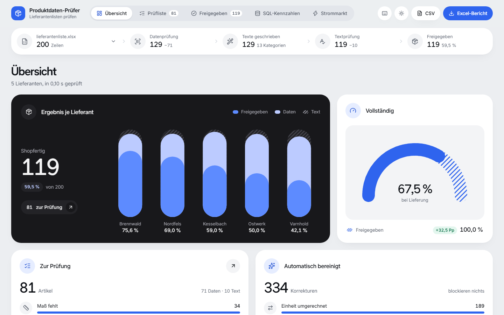
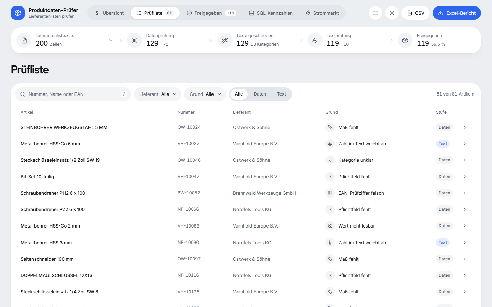
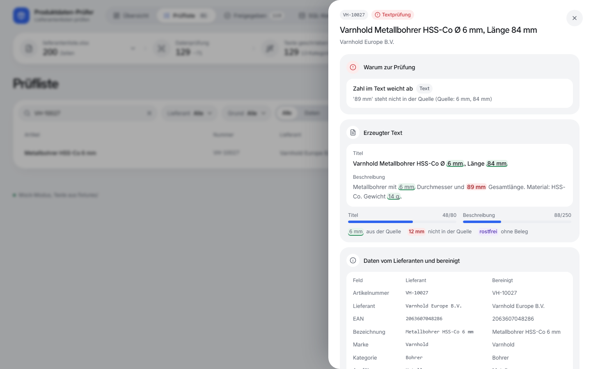
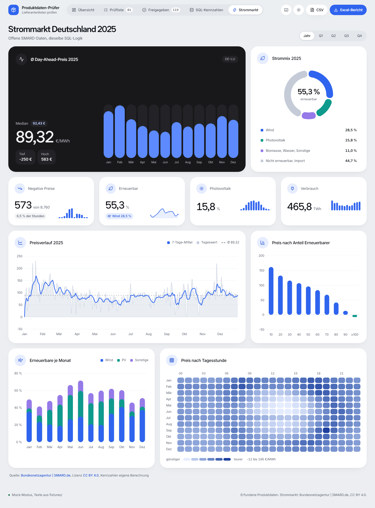
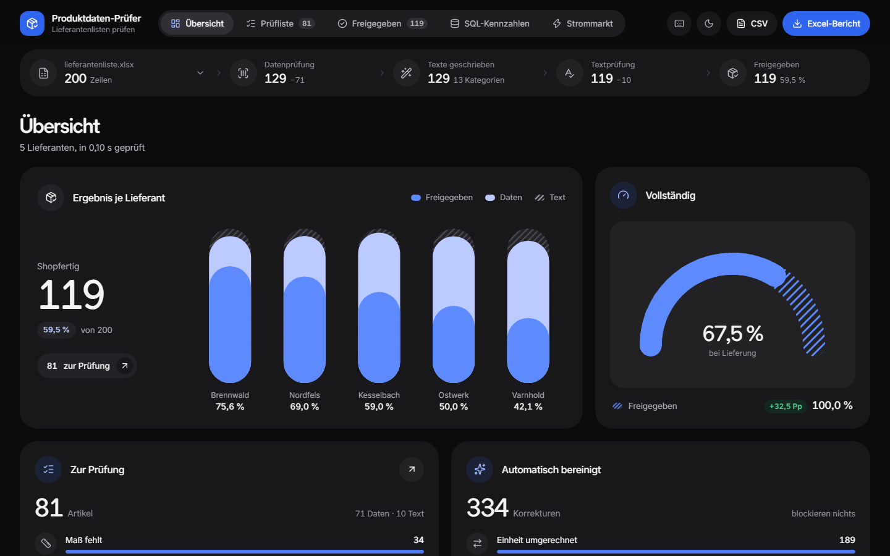
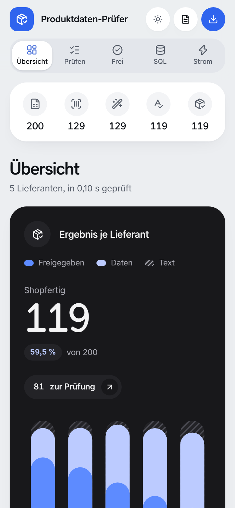
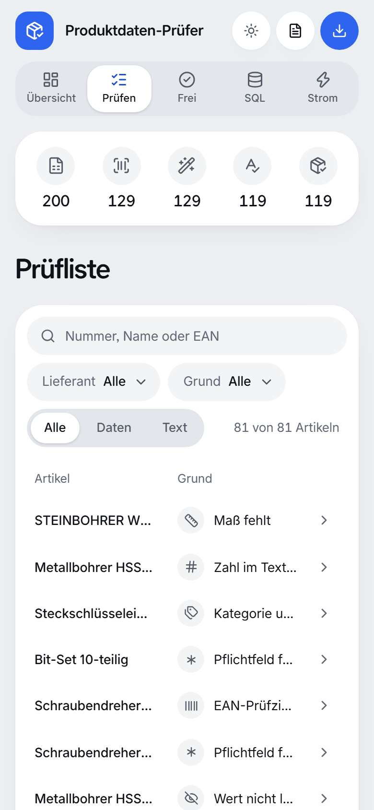
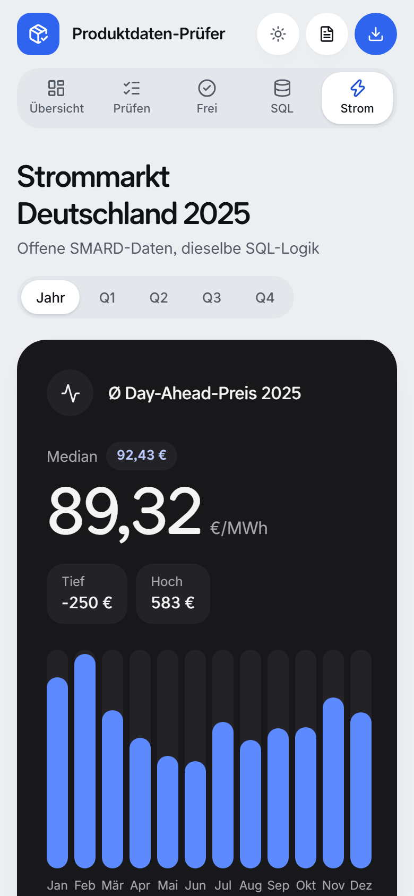
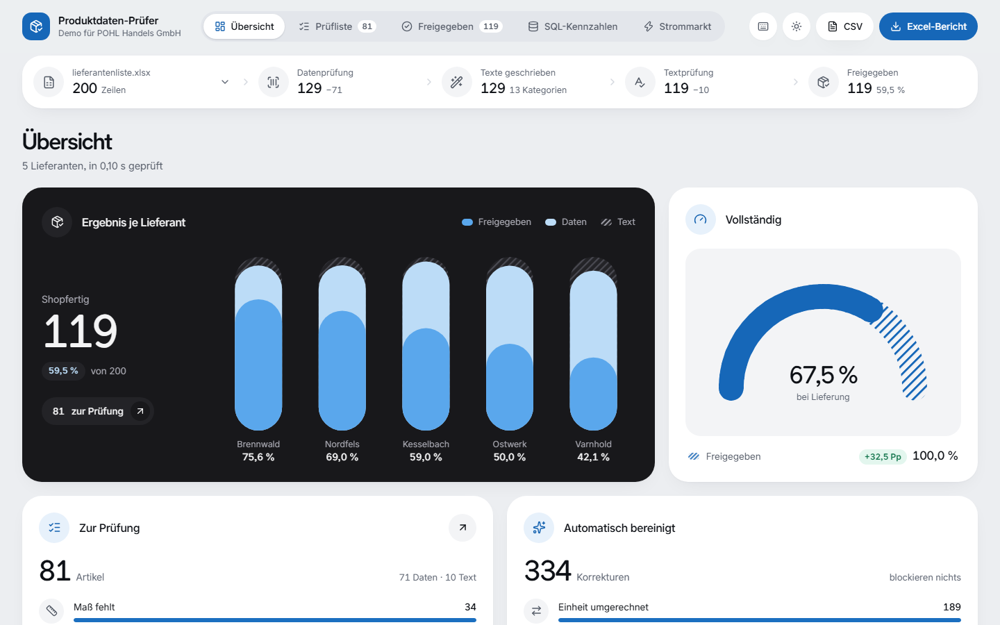
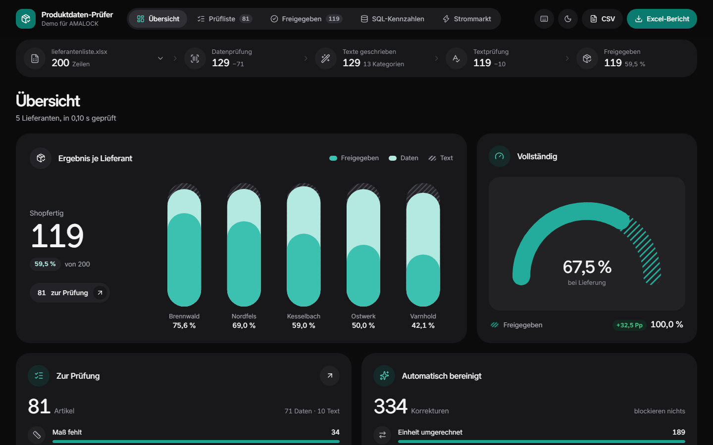

# Product Data Checker

[](.github/workflows/tests.yml)  [](LICENSE)

Cleans a messy supplier product list, writes product copy with a language model under
hard rules, checks every number in that copy against the source, and reports data
quality KPIs in SQL. Everything runs offline; the model has a mock mode with fixed
answers, so the whole demo costs nothing to run.

Demo C of three small portfolio projects: Python, pandas, SQL (DuckDB), Excel output
and a guarded LLM step. MIT licensed, see [LICENSE](LICENSE).



## Problem

A tool wholesaler receives product lists from five suppliers. Every supplier writes
units differently (`12mm`, `1,2 cm`, `0.125 m`, a bare `125`), some EANs have a wrong
check digit or were destroyed by Excel's scientific notation (`2,16297E+12`), articles
arrive twice, mandatory fields are empty, and free-text columns contain spreadsheet
formulas and even instructions aimed at an AI. Copying this into a shop by hand is
slow, and letting a model write product texts from it invites invented facts
("VDE-tested", "rustproof", a changed length).

## How it works

```
supplier list (.xlsx or .csv, 200 rows)
  -> safe import        size, row, column and cell limits; no macros; formulas stay inert text
  -> normalise          units to mm and g, prices to EUR, materials to one spelling
  -> classify           missing category: Claude Haiku picks from a fixed list (enum), or "unclear"
  -> validate           EAN-13/EAN-8 check digit, mandatory fields per category, plausibility, duplicates
  -> write copy         only for clean articles: Claude Sonnet gets structured facts, returns JSON
  -> check copy         every number must exist in the facts (unit changes allowed, values not),
                        risky claims need a source, length and format rules in code
  -> report             Excel (Sauber, Prüfen, Kennzahlen), clean CSV, dashboard
  -> KPIs in SQL        DuckDB on the run's tables: completeness, error rate per supplier, reasons
```

The model never sees the supplier's free-text note (brand, variant and material reach it
only capped in length and scanned for instructions), never calculates and never decides
on its own: its output has to fit a schema and pass the checks, otherwise the article goes to
the review list with the reason. See [DECISIONS.md](DECISIONS.md).

A second tab applies the same SQL approach to open electricity market data from
SMARD (Bundesnetzagentur): hourly day-ahead prices, load and generation for 2025,
fetched once and stored in the repo (`data/smard/`).

## Result

Measured on the included demo list (200 invented rows, mock model answers):

| | |
| :--- | :--- |
| Released (clean data and checked copy) | **119 of 200** (59.5 %) |
| Sent to review, each with a reason | 81 |
| Articles with all mandatory fields usable, before | 67.5 % |
| ... among released articles | 100 % |
| Planted data defects found | 9/9 wrong check digits, 3/3 EANs in scientific notation, 2/2 malformed EANs, 6/6 duplicates |
| Planted copy defects blocked | **10/10** (changed number, wrong unit, invented VDE/rustproof/warranty claims, title too long, leading dash, wrong piece count, link, prose instead of JSON) |
| Correct copy wrongly blocked | 0 of 5 planted correct variants (2 with the length in cm, 3 phrased like real model copy: "besteht aus", "Bestellnummer") plus 9 sentences in the regression catalogue |
| Pipeline run time | 0.09 s for 200 rows; full `pdc build` incl. Excel, CSV and dashboard about 1.8 s |

Be clear about what these numbers are: the defects were planted by the same author who
wrote the checks, so they prove the checks work as designed, not how often a real
model makes mistakes. Hit rate, cost per article and time saved against manual work
can only be measured with the real API and a hand-checked sample; that run has not
been done yet (see Limits).

| | |
| :--- | :--- |
|  |  |
|  |  |

| | | |
| :--- | :--- | :--- |
|  |  |  |

More: [released list](docs/screenshots/neutral-light-freigegeben.png),
[SQL KPIs](docs/screenshots/neutral-light-sql.png),
[chart tooltip](docs/screenshots/neutral-light-tooltip.png),
[dark electricity market](docs/screenshots/neutral-dark-strommarkt.png).

## The dashboard

An analysis app, not a page of cards, built to be read in a second: short labels, big
numbers, an icon for every step, reason and fix. One header bar holds the brand, the five
views as a segmented tab track (overview, review list, released list, SQL KPIs, electricity
market), light/dark, the keyboard help and the exports; it stays at the top while you
scroll. Under it the run is a flow of five steps with icon and number: the file (a
dropdown with rows, suppliers, run time and mode), data check, copy written, copy check,
released. The two checks also filter the review list. A step is only marked while the
list is filtered to it, so the bar never competes with the active tab.

- **Overview:** a bento grid with one dark hero card: the released count and one pill per
  supplier, all the same height, filled from the bottom with released (accent), stopped at
  the data (light accent) and stopped at the copy (hatched). Each column stays one
  continuous pill; a click opens that supplier's review list. Next to it completeness as
  a thick half ring (on delivery, and hatched up to the released articles). Below, the
  review reasons and the automatic fixes as lists like a banking app's spending
  categories: icon, name, count and a thin pill bar.
- **Review list:** search (`/`), pill dropdowns for supplier and reason, a stage switch,
  one-line rows (article, number, supplier, reason with its icon, stage) that open a
  detail sheet: why the article stopped, the generated copy with every
  number marked (backed by the source, not in the source, claim without evidence), and
  the supplier's raw values next to the cleaned ones.
- **Released:** product cards with a category icon, the checked title, supplier and
  price; the copy, its number marks and the length meters sit in the detail sheet.
- **SQL KPIs:** every query file with highlighted SQL (collapsible, copy button) and its
  result table, grouped into data quality and electricity market.
- **Electricity market:** a year or quarter switch that recomputes every KPI exactly from
  the SQL sums, a dark hero with the average price and the monthly prices as pills, the
  mix as a ring, the price as a calm 7-day mean over the faint daily values with a
  crosshair, prices by renewable share, renewables per month and the hour-by-month price
  heatmap with rounded cells.
- **Details that make it a finished tool:** favicon and a page title per view, skeletons
  while loading, empty states with a way out, a 404 view and styled server error pages,
  keyboard shortcuts (`1` to `5`, `/`, `?`, `T`) with a help dialog, and a phone layout
  with an even five-tab bar.

### Look

Modern rounded SaaS dashboard in a bento layout, on the design tokens of the companion
CRM demo: outer cards 28 px, inner cards 22 px, soft surfaces instead of lines, pills for
bars, tabs, switches, dropdowns and buttons, round icon circles, big numbers in a medium
weight. A selection is a raised surface on a grey track (white in light mode, one step
lighter in dark mode), never a black or white block, and each area has at most one
highlighted element. Light by default, dark mode in deep
neutral black (`#0b0b0c` page, `#18181b` cards), switchable and remembered. Type is
[Allo](docs/CREDITS.md) (variable, SIL OFL) with tabular figures. No gradients, glow or
noise; hatching is a pattern. Everything that changes moves, short and springy (150 to
300 ms): pressed buttons sink a little, the tab and step highlights glide, views cross
fade, dropdowns, dialogs and tooltips open and close, numbers count up and glide to new
values, bars grow. `prefers-reduced-motion` turns it all off.

Charts follow one rule for colour: the accent means "released" or the main series; the
two review reasons are two quiet slate steps, so the eye reads the accent as good at
once. Red appears only for errors.

## Accents per company

The dashboard is shown to several companies. Each gets one calm, cool accent colour, in
light and dark; layout, type and everything else stay the same:

```
http://127.0.0.1:3230/?firma=gedore
```

| Accent | Link parameter | Colour | Screenshots |
| :--- | :--- | :--- | :--- |
| neutral | none | blue | [light](docs/screenshots/neutral-light-uebersicht.png), [dark](docs/screenshots/neutral-dark-uebersicht.png) |
| GEDORE Gruppe | `?firma=gedore` | deep blue | [light](docs/screenshots/gedore-light-uebersicht.png), [dark](docs/screenshots/gedore-dark-uebersicht.png) |
| POHL Handels GmbH | `?firma=pohl` | cerulean blue | [light](docs/screenshots/pohl-light-uebersicht.png), [dark](docs/screenshots/pohl-dark-uebersicht.png) |
| AMALOCK | `?firma=amalock` | teal | [light](docs/screenshots/amalock-light-uebersicht.png), [dark](docs/screenshots/amalock-dark-uebersicht.png) |
| metergrid | `?firma=metergrid` | blue with green; starts on the electricity market | [light](docs/screenshots/metergrid-light-strommarkt.png), [dark](docs/screenshots/metergrid-dark-strommarkt.png), [phone](docs/screenshots/metergrid-mobile-strommarkt.png) |

| | | |
| :--- | :--- | :--- |
|  |  |  |

The accents contain no logo, image or text of these companies, and the demo is not
affiliated with them. Only cool tones are used (blue, teal, green), never yellow, gold,
orange or brown, even where a company's site looks that way.

How it works: all colours are CSS custom properties in
`frontend/src/styles/tokens.css`, one block per mode and one per accent and mode.
`frontend/public/boot.js` runs before the first paint, compares `?firma=` with a fixed
list and sets `data-theme` and `data-mode`; anything else (unknown, differently cased,
`__proto__`, markup) falls back to neutral and is never written into the page.
WCAG AA contrast is checked twice: computed from the tokens for every accent in light
and dark in `tests/test_themes.py` (text 4.5:1, chart marks and focus 3:1) and on the
rendered pages of every view in `e2e/test_themes_e2e.py`. `uv run pdc build --firma
gedore` also colours the header of the Excel sheet Kennzahlen.

## Run it

Requirements: Python 3.13 and [uv](https://docs.astral.sh/uv/). Node is only needed to
change the dashboard: the built app ships inside the package.

```bash
uv sync --all-groups         # install, incl. test and browser-test tools
uv run pdc build             # check data/raw/lieferantenliste.xlsx, write build/
uv run pdc serve             # dashboard on http://127.0.0.1:3230
```

### The frontend

React 19, Vite, [shadcn/ui](https://ui.shadcn.com) components on the app's own design
tokens, Recharts and motion, in `frontend/`. `npm run build` writes the app into
`src/product_data_checker/dashboard/web/`; `pdc build` copies it next to `data.json`.

```bash
cd frontend
npm ci
npm run dev                  # Vite dev server; reads data.json, so run pdc build first
npm run build                # type check and production build into the package
```

The build has no inline script or style: the strict Content-Security-Policy of
`pdc serve` stays as it is (`script-src 'self'`, `style-src 'self'`, fonts only from
the same origin). The modal parts that would inject a `<style>` tag (Radix scroll lock)
are replaced by native `<dialog>` elements.

Outputs in `build/`: `ergebnis.xlsx` (sheets Sauber, Prüfen, Kennzahlen), `sauber.csv`,
`site/` (dashboard), `run.json` (counts and run time).

Your own list: `uv run pdc build --input path/to/list.csv` (`.csv` or `.xlsx`, max 5 MB
and 5,000 rows, German or English header names, see `config.py`).

Real model instead of mock answers: copy `.env.example` to `.env`, add
`ANTHROPIC_API_KEY`, then `uv run pdc build --mode claude`. The key is read only from
that file. Answers are cached in `build/cache/`, so a second run costs nothing.

### Tests

```bash
uv run pytest                      # 272 unit and integration tests
uv run playwright install chromium # once, for the browser tests
uv run pytest e2e                  # 50 headless browser tests (desktop and phone, every accent, light and dark)
uv run ruff check . && uv run ruff format --check .
```

What is covered: EAN check digits (worked example by hand), unit parsing, input limits
and rejected files (macros, renamed macro workbooks, XML entity bombs, a cell in column
XFD, oversized CSV fields), every planted defect, a regression catalogue of correct
German sentences, bypass attempts on the link, HTML and claim rules (bare domains,
long tags, zero-width spaces, soft hyphens, Cyrillic look-alikes), prompt injection
through the variant column, SQL results cross-checked against an independent pandas
calculation, Excel/CSV output free of live formulas, the real-mode request shape
against a fake client (models, structured output, refusal and error handling, damaged
cache, no key in `repr`), server headers, path traversal and foreign `Host` headers,
and in the browser: navigation, keyboard-operable dropdowns, the detail sheet, empty
and error states, an XSS attempt through supplier data, and on a phone the tab bar,
the dropdown position and readable chart labels. Every accent is opened in every view
in light and dark, with the detail sheet, a dropdown, the empty and the error state and
on a phone, and audited for contrast; hostile `?firma=` values fall back to neutral.
Also: the steps and chart columns as filters, keyboard shortcuts and help, light/dark
remembered, the 404 view, page titles, reduced motion, and the quarter switch giving the
exact year value back. Any console error fails a browser test, CSP violations included.

Regenerate the demo data or mock answers (deterministic):

```bash
uv run python scripts/generate_supplier_data.py
uv run python scripts/build_mock_fixtures.py
uv run python scripts/fetch_smard.py --year 2025   # network, only to refresh SMARD
uv run python e2e/screenshots.py                   # needs a running `pdc serve`, all accents
```

## Project layout

```
src/product_data_checker/
  ingest.py        safe import, formula neutralisation
  units.py ean.py  parsing and check digits
  cleaning.py      normalisation, mandatory fields, duplicates
  llm.py prompts.py  mock and Claude providers, schemas, prompts
  guard.py         fact check of generated copy
  pipeline.py      the run
  metrics.py sql/  DuckDB KPIs, one .sql file per query
  report_excel.py  Excel and CSV
  dashboard/       payload for data.json; web/ is the built frontend
  server.py cli.py
frontend/          React app (Vite, shadcn/ui, Recharts), design tokens in src/styles/
data/raw/          invented supplier list (.xlsx and .csv)
data/smard/        SMARD hourly data 2025 (CC BY 4.0)
fixtures/llm/      mock model answers incl. planted defects
tests/ e2e/        pytest and Playwright
```

## Limits

- Mock answers are template text with planted defects, not real model output. Copy
  quality, hit rate, tokens and cost per article are not measured yet.
- The number check compares digits and units. It does not understand number words
  ("zwei"), and it cannot tell whether a correct number sits in the wrong sentence.
- The claim list (VDE, rustproof, warranty, ...) is a fixed list; a new kind of
  invented claim without a number passes unless it is added.
- Brand, variant and material are supplier text and do reach the model. They are
  capped (60, 120 and 60 characters) and scanned for instructions; a cleverly worded
  injection without trigger words would still be sent, but cannot release a promise:
  warranty, lifetime, superlative and "Profi" claims are never backed by the variant,
  VDE only together with a voltage. A short spec-like variant still backs technical
  marks such as "isoliert"; whether that fact is true is not checked.
- Duplicates are found by EAN and article number, not by fuzzy name matching.
- No upload in the dashboard: files are checked through the CLI. The dashboard is a
  read-only view of one run.
- For 5,000+ articles the real mode should use the Batches API (half price, async);
  the code currently sends single requests with 4 workers.

Data: all product data is invented. EANs use the GS1 prefix range 20 to 29 (restricted
circulation), which is never assigned to real products. Electricity data: Bundesnetzagentur |
SMARD.de, licensed [CC BY 4.0](https://creativecommons.org/licenses/by/4.0/). Icons:
Lucide (ISC). Font: Allo by Josh Puckett (SIL OFL, licence next to the file); see
[docs/CREDITS.md](docs/CREDITS.md).

---

## Kurzfassung (Deutsch)

**Problem.** Lieferantenlisten sind unsauber: Einheiten in jeder Schreibweise, EANs mit
falscher Prüfziffer oder von Excel zerstört, Dubletten, leere Pflichtfelder, Formeln und
sogar Anweisungen an eine KI im Freitext. Texte von einem Sprachmodell erfinden gern
Eigenschaften oder verändern Zahlen.

**Ablauf.** Sicherer Import mit Grenzen, Einheiten auf mm und g, EAN-Prüfziffer im Code,
Pflichtfelder je Kategorie, Dubletten. Fehlende Kategorien ordnet Claude Haiku aus einer
festen Liste ein. Nur saubere Artikel bekommen Titel und Kurzbeschreibung von Claude
Sonnet; danach vergleicht ein Check jede Zahl im Text mit der Quelle und sucht
unbelegte Eigenschaften. Alles, was nicht passt, geht mit Grund in die Prüfliste.
Ausgabe: Excel mit den Blättern Sauber, Prüfen, Kennzahlen, eine CSV und ein Dashboard.
Die Kennzahlen rechnet DuckDB in SQL. Zweiter Tab: dieselbe SQL-Logik auf
SMARD-Strommarktdaten 2025.

**Ergebnis (gemessen auf der Demo-Liste).** 119 von 200 Artikeln freigegeben, 81 mit
Grund zur Prüfung. Vollständige Pflichtfelder vorher 67,5 %, bei den freigegebenen
100 %. Alle eingebauten Datenfehler gefunden, alle 10 eingebauten Textfehler gestoppt,
keine der 5 korrekten Varianten blockiert (auch nicht „besteht aus“). Laufzeit 0,09 s für 200 Zeilen. Wichtig: Die
Fehler sind selbst eingebaut. Trefferquote, Kosten und Zeitersparnis mit dem echten
Modell sind noch nicht gemessen.

**Grenzen.** Mock-Antworten statt echter Modelltexte, Zahlwörter werden nicht geprüft,
die Liste unbelegter Eigenschaften ist fest, Dubletten nur über EAN und Artikelnummer,
kein Upload im Dashboard.

**Dashboard.** Eine Analyse-App im Bento-Look, hell oder dunkel (tiefes Schwarz,
gespeichert), auf einen Blick lesbar: kurze Beschriftungen, große Zahlen, ein Icon je
Schritt, Grund und Korrektur. Eine Kopfzeile mit den Reitern Übersicht, Prüfliste,
Freigegeben, SQL-Kennzahlen und Strommarkt und dem Excel-Export, darunter der Lauf als
Fluss aus fünf Schritten, die zugleich filtern. Dunkle Hero-Karte mit einer Pille je
Lieferant, Halbring für die Vollständigkeit, Gründe und Korrekturen als Listen mit Icon
und Pillen-Balken, Detail-Ansicht mit markierten Zahlen im Text,
Preisverlauf als ruhiges 7-Tage-Mittel und ein Quartalsschalter, der alle Kennzahlen
exakt aus den SQL-Summen neu rechnet. Alles, was sich ändert, ist kurz animiert (aus bei
reduzierter Bewegung). Gebaut mit React, Vite, shadcn/ui und Recharts; das fertige
Frontend liegt im Paket, `pdc serve` braucht kein Node.

**Akzentfarbe je Firma.** Per Link `?firma=gedore`, `pohl`, `amalock` oder `metergrid`
(dort steht der Strommarkt vorn) bekommt das Dashboard eine ruhige, kühle Akzentfarbe,
in Hell und Dunkel. Keine Logos oder Texte der Firmen, kein Gelb, Gold oder Orange.
Kontrast WCAG AA je Akzent in beiden Modi, per Test geprüft.

**Start.** `uv sync --all-groups`, `uv run pdc build`, `uv run pdc serve` (Port 3230).
Frontend ändern: `cd frontend && npm ci && npm run build`.
**Tests.** `uv run pytest`, `uv run pytest e2e`.
